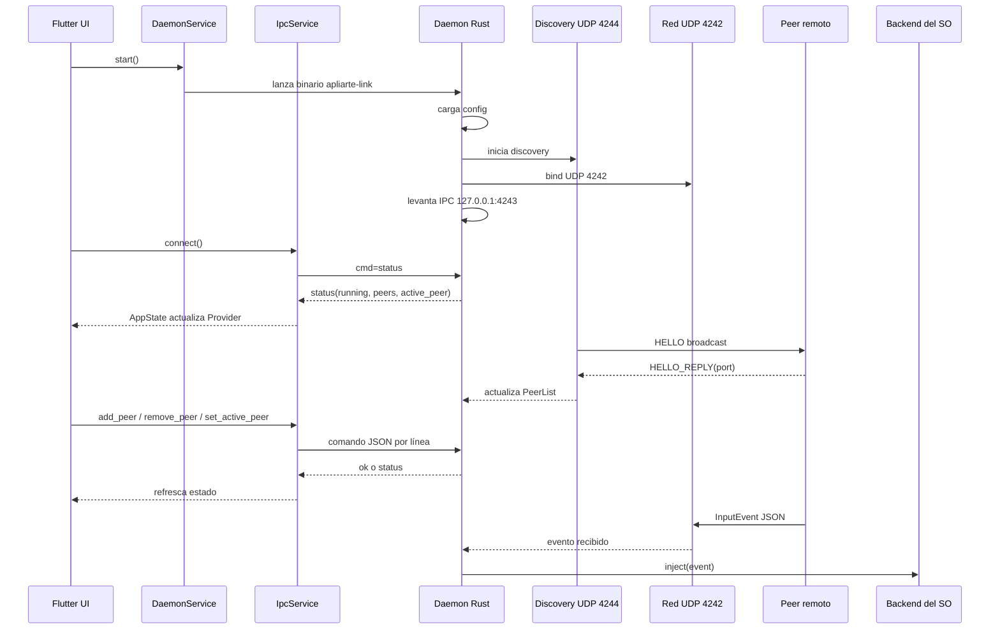
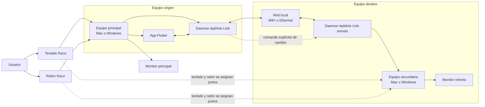

# Diagramas de ApliArte Link

Estos diagramas describen el runtime verificado en el código actual.

Se apoyan en estas rutas:

- `native/daemon/src/main.rs`
- `native/daemon/src/ipc/mod.rs`
- `native/daemon/src/network/mod.rs`
- `native/daemon/src/network/discovery.rs`
- `native/daemon/src/input/mod.rs`
- `apps/apliarte_link/lib/services/daemon_service.dart`
- `apps/apliarte_link/lib/services/ipc_service.dart`
- `apps/apliarte_link/lib/providers/app_state.dart`

## Diagrama de arquitectura

```mermaid
flowchart LR
    UI[Flutter Desktop UI\napps/apliarte_link] --> STATE[AppState + Provider]
    UI --> DAEMON_SVC[DaemonService\nlanza el binario Rust]
    STATE <--> IPC_SVC[IpcService\nTCP loopback 127.0.0.1:4243]

    subgraph LOCAL[Equipo local]
        IPC_SVC <--> IPC[IPC server\nJSON Lines]
        DAEMON_SVC --> MAIN[main.rs\norquestación Tokio]
        MAIN --> CFG[config.rs\ncarga y persistencia]
        MAIN --> IPC
        MAIN --> DISC[network/discovery.rs\nUDP 4244 HELLO / HELLO_REPLY]
        MAIN --> NET[network/mod.rs\nUDP 4242 InputEvent]
        MAIN --> INPUT[input/mod.rs\ncanal de eventos + inyección]
        NET -->|InputEvent recibido| INPUT
        IPC -->|status / ok / error| IPC_SVC
        INPUT --> OS[Backends del SO\nmacOS | Windows | Linux]
    end

    subgraph REMOTE[Equipo remoto]
        PEER[Daemon ApliArte Link remoto]
    end

    DISC <--> PEER
    NET <--> PEER
    IPC_SVC --> STATE
```

## Diagrama de flujo operativo



## Diagrama guía de conexión entre periféricos y dispositivos

Este diagrama es conceptual. Sirve para explicar al usuario cómo se relacionan los periféricos físicos con los equipos enlazados por ApliArte Link.

Para la primera versión, la intención de producto es que el traspaso de control sea por comando explícito configurable y que teclado + ratón viajen juntos al mismo equipo. El cambio automático por borde de pantalla no debe tratarse como flujo principal del MVP hasta que esa UX esté validada.



## Nota

El flujo de captura local y envío de input no se dibuja aquí como ruta verificada porque, en el estado actual del código leído, el punto de entrada conectado en `main.rs` confirma claramente descubrimiento, IPC, recepción de eventos de red e inyección en el SO. Si se conecta la captura local en otro módulo o en una iteración posterior, conviene ampliar este documento con ese camino explícito.

La decisión de UX para el MVP puede ir por delante del runtime actual: una cosa es la dirección de producto y otra lo que hoy está cableado en código. Este documento intenta separar ambas capas para no dar por implementado algo que todavía no está verificado.